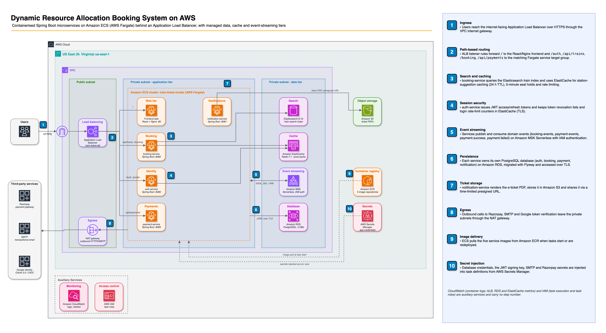
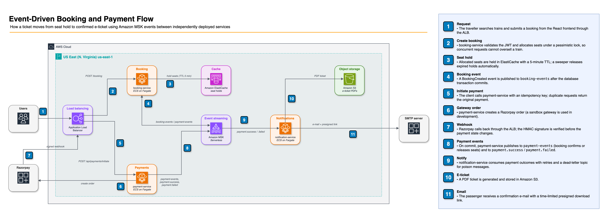

<div align="center">

# Dynamic Resource Allocation Booking System

**A cloud-native, event-driven train-ticket booking platform built from Spring Boot microservices and deployed on AWS (Amazon ECS on Fargate)**


*Final-year B.E. (Computer Science & Engineering) major project, Global Academy of Technology, Bengaluru (VTU), 2026-27*
*Project theme: Dynamic Resource Allocation and Intelligent Auto-Scaling Using AWS Services*

</div>

---

## Table of contents

1. [Overview](#overview)
2. [AWS architecture](#aws-architecture)
3. [Event-driven booking and payment flow](#event-driven-booking-and-payment-flow)
4. [Microservices](#microservices)
5. [AWS services used](#aws-services-used)
6. [Engineering highlights](#engineering-highlights)
7. [API surface](#api-surface)
8. [Repository layout](#repository-layout)
9. [Getting started](#getting-started)
10. [Deployment](#deployment)
11. [Research context and future work](#research-context-and-future-work)
12. [Team](#team)

---

## Overview

The system is a railway reservation platform split into four independently deployable Spring Boot services: **authentication**, **booking**, **payment** and **notification**. A React + TypeScript frontend is served by Nginx. Each service runs as its own task on an **Amazon ECS cluster using AWS Fargate**, sits behind an internet-facing **Application Load Balancer**, owns a separate **PostgreSQL** database on **Amazon RDS**, and talks to the other services asynchronously through **Amazon MSK Serverless** (Apache Kafka).

The project studies how a microservice workload can be split so that compute, cache, search and database capacity can each be **allocated and scaled independently** instead of scaling a single monolith.

| Capability | How it is delivered |
|---|---|
| Train search over ~30,000 railway records | Elasticsearch full-text index, fed in batches of 1,000 from a CSV importer |
| Low-latency station suggestions | Read-through cache in ElastiCache (Redis) with a 24-hour TTL and fallback to Elasticsearch |
| No double-booking under concurrency | Pessimistic row locks per train and date, plus 5-minute seat holds with automatic expiry |
| Safe payments | Razorpay integration, idempotency keys, HMAC-verified webhooks, background recovery job |
| Reliable notifications | Kafka consumers with retries and dead-letter topics; PDF e-tickets in S3 behind presigned URLs |
| Security | JWT access and refresh tokens, Google Sign-In, token revocation, Redis-backed rate limiting |

---

## AWS architecture



> Editable source: [`docs/architecture/aws-deployment-architecture.drawio`](docs/architecture/aws-deployment-architecture.drawio). Open it in [draw.io](https://app.diagrams.net/).

**Network layout.** All workloads run in a single VPC in `us-east-1`. Only the Application Load Balancer and the NAT gateway sit in the public subnet. The Fargate tasks run in a private application subnet, and the stateful tier (RDS, ElastiCache, MSK, Elasticsearch) runs in a private data subnet with no inbound internet path. Outbound calls to Razorpay, SMTP and Google leave through the NAT gateway.

**Request path.** ALB listener rules route traffic by path prefix to a target group per service:

| Path prefix | Target ECS service | Container port |
|---|---|---|
| `/` | frontend (React + Nginx) | 80 |
| `/auth/*`, `/profile/*` | auth-service | 8080 |
| `/api/trains/*`, `/booking/*` | booking-service | 8082 |
| `/api/payments/*` | payment-service | 8083 |
| *(internal only)* | notification-service | 8081 |

**Configuration and secrets.** Task definitions pull images from Amazon ECR and read database credentials, the JWT signing key, SMTP credentials and Razorpay keys from AWS Secrets Manager at task start. No secret is stored in source control. Container logs and ALB, RDS and ElastiCache metrics are collected in Amazon CloudWatch.

---

## Event-driven booking and payment flow



> Editable source: [`docs/architecture/event-driven-booking-flow.drawio`](docs/architecture/event-driven-booking-flow.drawio)

Services never call each other synchronously on the critical path of a payment. Instead they exchange domain events on Kafka topics:

| Topic | Producer | Consumer(s) | Purpose |
|---|---|---|---|
| `booking-events` | booking-service | (audit / downstream) | `BookingCreated` / `BookingFailed` after the DB transaction commits |
| `payment-events` | payment-service | booking-service | Confirm the booking or release held seats |
| `payment.success` | payment-service | notification-service | Generate the e-ticket and send the confirmation e-mail |
| `payment.failed` | payment-service | notification-service | Notify the passenger of a failed payment |
| `*.DLT` | Spring Kafka error handler | operators | Dead-letter topics for messages that still fail after retries |

On AWS the brokers are **Amazon MSK Serverless**, reached over `SASL_SSL` with **IAM authentication** (`aws-msk-iam-auth`), so services authenticate with their ECS task role instead of static credentials.

---

## Microservices

Each service lives in its own repository and is included here as a **git submodule** under [`services/`](services).

| Service | Repository | Port | Responsibilities | Data stores |
|---|---|---|---|---|
| **Authentication** | [`authentication_service`](https://github.com/bhushanrkashyap/authentication_service) | 8080 | Registration with e-mail verification, login, Google Sign-In, JWT access/refresh tokens, logout and token revocation, password reset, profile management, rate limiting | RDS `auth_service`, ElastiCache |
| **Booking** | [`booking_service`](https://github.com/bhushanrkashyap/booking_service) | 8082 | Train search, station suggestions, seat availability, seat allocation by berth preference, PNR generation, booking lifecycle, travel reminders | RDS `booking_service`, ElastiCache, Elasticsearch, MSK |
| **Payment** | [`payment_service`](https://github.com/bhushanrkashyap/payment_service) | 8083 | Payment initiation, Razorpay and sandbox gateways, webhook verification, idempotency, payment-window expiry, recovery of stuck payments | RDS `payment_service`, MSK |
| **Notification** | [`notification_service`](https://github.com/bhushanrkashyap/notification_service) | 8081 | Event-driven e-mails, PDF ticket generation, S3 storage with presigned URLs, retry and scheduled reminders, per-recipient rate limiting | RDS `notification_service`, MSK, S3 |
| **Frontend** | [`Dynamic-Resource-allocation`](https://github.com/Bharathmn-2005/Dynamic-Resource-allocation) (team repo) | 80 | React 19 + TypeScript + Vite single-page app served by Nginx | - |

**Shared stack:** Java 21, Spring Boot 4.1 (notification-service on 3.2), Spring Security, Spring Data JPA, Flyway, Spring Kafka, Bucket4j, JJWT, OpenPDF/PDFBox, AWS SDK v2, Maven, multi-stage Docker images (Temurin 21 JRE on Alpine, non-root user, health checks).

---

## AWS services used

| Layer | Service | Role in the system |
|---|---|---|
| Compute | **Amazon ECS on AWS Fargate** | Runs the five containerised services (`train-ticket-cluster`) without managing servers |
| Networking | **Application Load Balancer** | Internet-facing entry point (`train-ticket-alb`) with path-based routing and target-group health checks |
| Networking | **Amazon VPC**, Internet gateway, NAT gateway | Public / private subnet isolation and controlled egress |
| Database | **Amazon RDS for PostgreSQL** | Database-per-service: `auth_service`, `booking_service`, `payment_service`, `notification_service` |
| Cache | **Amazon ElastiCache (Redis 7.1)** | Station-suggestion cache, seat holds, rate-limit buckets, token revocation (`prod-cache`, TLS) |
| Messaging | **Amazon MSK Serverless** | Kafka event backbone with IAM authentication |
| Storage | **Amazon S3** | E-ticket PDFs served through time-limited presigned URLs |
| Containers | **Amazon ECR** | One image repository per service |
| Security | **AWS Secrets Manager**, **AWS IAM** | Runtime secret injection and least-privilege task roles |
| Observability | **Amazon CloudWatch** | Container logs; ALB request/latency, target health, RDS I/O and ElastiCache metrics |

---

## Engineering highlights

- **Concurrency-safe seat allocation.** Seats are scheduled per train and date, with pessimistic locking during allocation so two concurrent requests cannot sell the same berth. The booking service has a dedicated concurrency test for overselling.
- **Seat holds with TTL.** Held seats expire automatically after 5 minutes, and a background sweeper releases abandoned holds back to inventory.
- **Publish after commit.** Domain events are published only after the database transaction commits, so consumers never see a booking or payment that was rolled back.
- **Idempotent payments.** Payment initiation is keyed by an idempotency key stored durably in PostgreSQL. Duplicate client retries return the original result instead of charging twice.
- **Verified webhooks.** Razorpay callbacks are accepted only after HMAC-SHA256 signature verification, and a recovery job reconciles payments stuck in an intermediate state.
- **Resilient consumers.** Kafka listeners use bounded exponential retries and dead-letter topics, so a poison message cannot block a partition.
- **Defence in depth.** Stateless JWT authentication in every service, refresh tokens, Redis-backed token revocation, and Bucket4j / Redis rate limiting on login, registration, booking, payment and e-mail sending.
- **Cache-aside with graceful degradation.** Station suggestions are served from Redis. On a cache miss or a Redis outage, the service falls back to Elasticsearch instead of failing.
- **Schema migrations.** Booking and payment schemas are versioned with Flyway (`V1`-`V5` for payments), and Hibernate validates the schema at startup.
- **Production-grade containers.** Multi-stage Docker builds, a non-root runtime user, container `HEALTHCHECK`s against `/actuator/health`, and all configuration supplied through environment variables.

---

## API surface

<details>
<summary><b>Authentication service</b> (<code>:8080</code>)</summary>

| Method | Endpoint | Description |
|---|---|---|
| POST | `/auth/register` | Register and send a verification e-mail |
| GET | `/auth/verify-email` | Verify the e-mail address |
| POST | `/auth/login` | Issue access and refresh tokens |
| POST | `/auth/oauth/google` | Sign in with a Google ID token |
| POST | `/auth/refresh-token` | Exchange a refresh token for a new access token |
| POST | `/auth/logout` | Revoke tokens |
| PUT | `/auth/change-password` | Change the password |
| POST | `/auth/forgot-password`, `/auth/reset-password` | Password reset flow |
| GET / PUT | `/profile/get-profile`, `/profile/update` | Profile management |

</details>

<details>
<summary><b>Booking service</b> (<code>:8082</code>)</summary>

| Method | Endpoint | Description |
|---|---|---|
| GET | `/api/trains/search` | Search trains by source, destination, date or train number |
| GET | `/api/trains/{trainId}` | Train details |
| GET | `/api/trains/{trainId}/availability` | Seat availability |
| GET | `/api/stations/suggestions` | Cached station autocomplete |
| POST | `/booking` | Create a booking (seat allocation and hold) |
| GET | `/booking/my` | Bookings of the current user |
| GET / DELETE | `/booking/{bookingId}` | Booking details or cancellation |

</details>

<details>
<summary><b>Payment service</b> (<code>:8083</code>)</summary>

| Method | Endpoint | Description |
|---|---|---|
| POST | `/api/payments/initiate` | Start a payment (idempotent) |
| POST | `/api/payments/{paymentId}/confirm` / `fail` / `cancel` | Client-side outcome |
| POST | `/api/payments/webhook` | Razorpay webhook (signature-verified) |
| GET | `/api/payments/{paymentId}`, `/api/payments/me`, `/api/payments/booking/{bookingId}` | Payment queries |

</details>

<details>
<summary><b>Notification service</b> (<code>:8081</code>, internal)</summary>

| Method | Endpoint | Description |
|---|---|---|
| GET | `/api/v1/notifications/{id}`, `/user/{userId}`, `/booking/{bookingId}` | Notification history |
| GET | `/api/v1/notifications/{id}/ticket` | Download the PDF e-ticket |
| POST | `/api/v1/notifications/{id}/retry` | Retry a failed notification (max 3 attempts) |
| POST | `/api/v1/notifications/booking-success`, `booking-failure`, `payment-success`, `payment-failure`, `reminder` | Direct notification triggers |

</details>

---

## Repository layout

```
Dynamic-Resource-Allocation-Booking-System/
├── docs/
│   └── architecture/
│       ├── aws-deployment-architecture.drawio   # editable source
│       ├── aws-deployment-architecture.png
│       ├── event-driven-booking-flow.drawio
│       └── event-driven-booking-flow.png
└── services/                                    # git submodules
    ├── authentication-service  -> bhushanrkashyap/authentication_service
    ├── booking-service         -> bhushanrkashyap/booking_service
    ├── payment-service         -> bhushanrkashyap/payment_service
    └── notification-service    -> bhushanrkashyap/notification_service
```

---

## Getting started

### Clone with all services

```bash
git clone --recurse-submodules https://github.com/bhushanrkashyap/Dynamic-Resource-Allocation-Booking-System.git
cd Dynamic-Resource-Allocation-Booking-System

# already cloned without --recurse-submodules?
git submodule update --init --recursive

# pull the latest commit of every service
git submodule update --remote --merge
```

### Run a service locally

Prerequisites: JDK 21, Docker, and a local PostgreSQL / Redis / Kafka (plus Elasticsearch for the booking service).

```bash
cd services/booking-service
export BOOKING_DB_URL=jdbc:postgresql://localhost:5432/booking_service
export BOOKING_DB_USERNAME=postgres BOOKING_DB_PASSWORD=postgres
export JWT_SECRET=$(openssl rand -base64 48)
export REDIS_HOST=localhost KAFKA_BOOTSTRAP_SERVERS=localhost:9092
export ELASTICSEARCH_URL=http://localhost:9200
./mvnw spring-boot:run
```

Or build the container image exactly as it runs on Fargate:

```bash
docker build -t booking-service services/booking-service
```

Every setting is read from environment variables (see each service's `application.properties` / `application.yml`). In AWS those values come from the ECS task definition and AWS Secrets Manager.

---

## Deployment

The production environment runs in **`us-east-1`**:

1. Each service is built into a multi-stage Docker image and pushed to its **Amazon ECR** repository.
2. The **ECS cluster** `train-ticket-cluster` runs one **Fargate** service per component (5 services). Each task definition references its ECR image, a CloudWatch Logs group, and secrets stored in **AWS Secrets Manager**.
3. The **Application Load Balancer** `train-ticket-alb` forwards requests to the per-service target groups and health-checks `/actuator/health`.
4. Services connect to **Amazon RDS for PostgreSQL** (TLS), **Amazon ElastiCache** (`REDIS_SSL_ENABLED=true`), **Amazon MSK Serverless** (`SASL_SSL` + `AWS_MSK_IAM`) and **Amazon S3** using their IAM task roles.
5. Rolling updates are done by registering a new task-definition revision and updating the ECS service. ECS replaces tasks only after the new ones pass their health checks.

An earlier iteration ran the full stack on a single Ubuntu EC2 instance with Docker Compose and Amazon RDS. Moving to ECS on Fargate separated each service's lifecycle and resource allocation.

---

## Research context and future work

This repository is the implementation half of the major project **"Dynamic Resource Allocation and Intelligent Auto-Scaling Using AWS Services"**. The microservice split, the database-per-service design and the managed data tier are the foundation for scaling each component on its own signals, instead of over-provisioning a single host.

Areas identified for further work in the project report:

- **Metric-driven auto-scaling.** ECS Service Auto Scaling with target tracking on CPU, memory and ALB `RequestCountPerTarget`, validated under controlled load tests (JMeter / Locust).
- **Predictive scaling.** Forecasting demand from CloudWatch metrics (for example LSTM forecasts with an HMM workload-state classifier) to scale ahead of peak booking windows such as Tatkal hours.
- **Read scaling.** PostgreSQL read replicas with read/write splitting for search-heavy traffic.
- **Distributed locking.** Moving per-train seat-allocation locks from the JVM to Redis or the database, so allocation stays correct when the booking service runs as many tasks.
- **Observability.** Amazon Managed Service for Prometheus and Grafana dashboards, plus distributed tracing.
- **Multi-cloud resilience.** Cross-cloud database failover (for example Azure Database for PostgreSQL) for disaster recovery.

---

## Team

| Name | Role |
|---|---|
| **Bhushan R Kaashyap** | Backend microservices (authentication, booking, payment, notification), event-driven design, AWS deployment |
| Abhishek Gowda G D | Team member |
| Abhishek M | Team member |
| Bharath M N | Team member (frontend and deployment tooling) |

**Guide:** Prof. Archana M, Assistant Professor, Department of CSE, Global Academy of Technology, Bengaluru.

---

<div align="center">
<sub>Built as a final-year B.E. project at Global Academy of Technology, Bengaluru (affiliated to VTU, Belagavi).</sub>
</div>
